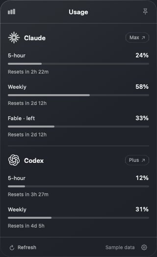

# LimitBar

A native macOS menu bar app for subscription limits across AI providers. The first two adapters are Claude and Codex. It shows provider-reported usage percentages, quota windows, reset countdowns, and Codex saved resets when available.



*Sample data. This layout preview does not capture the desktop's native glass effect.*

The floating panel uses Apple's native Liquid Glass on macOS 26, with a vibrancy fallback on earlier macOS versions. Its height follows the content. The header identifies whether percentages represent usage or remaining allowance; preferences switch between them. The pin keeps the panel open. Escape or a click outside closes an unpinned panel. The Codex section and menu bar use the OpenAI mark.

Each metric uses the same stacked layout: label and tabular percentage, full-width bar, and reset text. Bars are neutral below 70% consumed, amber at 70–90%, and red above 90%, regardless of whether the number shows used or remaining. Unknown metrics are hidden. Hover over reset times or the update timestamp for exact local dates and times. Saved Codex resets appear in the section's tooltip.

**Fable · left** always shows the remaining model-specific Fable allowance when Claude reports it. Its value is `100 - percent` from the matching `limits[].weekly_scoped` entry, not an estimate from shared weekly usage. Shared session/weekly limits remain visible because they also apply. Missing Fable data produces a compact unavailable message. Nested breakdown objects without measured utilization are not rendered as quotas. See [Claude's explanation of Fable allowances](https://support.claude.com/en/articles/15424964-claude-fable-models-on-your-plan).

## Run

Requires macOS 13 or later, Apple Command Line Tools, and Python 3 for the build helper. Tests require Swift 6.0 or later. Install Command Line Tools with `xcode-select --install` if needed. Each person signs in with their own Claude Code and Codex CLI accounts; no account credentials are included.

```sh
git clone https://github.com/printhelloworldboys/limitbar.git
cd limitbar
./scripts/build.sh
open dist/LimitBar.app --args --show
```

To install, copy `dist/LimitBar.app` to `~/Applications/`. Use the gear button for launch at login and the **Show remaining** preference. Right-click the menu bar item to quit. Pin keeps the panel open; click the menu bar item again to close it.

LimitBar checks every five minutes and after waking. **Refresh / ⌘R** checks immediately. The menu bar shows each provider’s most constrained reported quota window. Hover over a reset countdown for its full local date and time.

## Accounts

- **Claude:** sign in using `claude auth login`. LimitBar reads the existing Claude Code credential from `~/.claude/.credentials.json` or the `Claude Code-credentials` Keychain item. Click **Connect Claude** to allow the macOS Keychain prompt. Background refresh never prompts. If Claude Code’s credential expires, open Claude Code to renew it or sign in again, then refresh LimitBar. Custom `CLAUDE_CONFIG_DIR` profiles use only their own credential file.
- **Codex:** install Codex CLI, then run `codex login` with a ChatGPT subscription account. LimitBar locates the CLI in common user/Homebrew paths and uses its documented `account/read` and `account/rateLimits/read` methods. The CLI manages its own authentication. API-key-only accounts do not provide subscription quotas.

Codex figures describe **Codex subscription quotas**, not the separate message allowances in the ChatGPT chat interface. Claude’s OAuth usage endpoint is not a guaranteed public third-party API and can change or reject a token. Failures are displayed explicitly, with a link to each provider’s own dashboard.

## Data handling

LimitBar starts no model requests. It does not read conversations, persist tokens, modify Claude credentials, or send data to an intermediary. Claude requests go directly to `api.anthropic.com`; Codex uses the locally installed CLI. The only saved preferences are display mode and the operating system’s login-item registration.

Unknown percentages remain unavailable. Failed network refreshes retain the last successful measurement with its original timestamp and a stale label. Authentication/schema failures clear the old snapshot. A passed reset time never invents a new zero-usage window. Meter percentages are **used**, unless remaining mode is selected. The menu bar hides stale/expired values.

## Development and verification

```sh
./scripts/swift.sh test --disable-xctest
./scripts/build.sh
dist/LimitBar.app/Contents/MacOS/LimitBar --diagnose
dist/LimitBar.app/Contents/MacOS/LimitBar --preview --snapshot /tmp/limitbar-preview.png
```

Diagnostics report only plan names, percentages, reset timestamps, and sanitized errors. `--allow-keychain` permits an interactive Keychain prompt during diagnostics. `--preview` is explicitly labeled sample data and performs no provider requests. To render actual account state, omit `--preview` from the snapshot command.

Snapshots render the app's layout on a neutral background. They do not capture the desktop or the system compositor's glass effect. Add `--preview-settings` to inspect the preferences layout. No Screen Recording permission is needed for these app-local renders.

`scripts/swift.sh` detects stale duplicate Swift bridging module maps and old PackageDescription interfaces left by mixed Command Line Tools installs. It applies a project-local compiler filesystem overlay; it does not modify the system toolchain. A normal toolchain can also run `swift build` and `swift test` directly.

The app has no external package dependencies. The build script produces a locally ad-hoc-signed app. Building from source is the supported installation route; this repository does not provide a Developer ID-signed, notarized download.

## Adding a provider

Implement `UsageProvider.fetch`, return normalized `UsageSnapshot` / `UsageWindow` values, register the adapter in `UsageStore`, and add provider metadata in `ProviderID`. Keep authentication inside the adapter and validate the actual meaning and duration of each quota window. Add fixture tests for missing limits, null percentages, error responses, and reset semantics.

## Interface references

- [OpenAI Codex app server](https://learn.chatgpt.com/docs/app-server): subscription rate-limit RPC, percentages used, window lengths, Unix-second reset timestamps, and saved resets.
- [CodexBar’s Claude integration documentation](https://github.com/steipete/CodexBar/blob/main/docs/claude.md): Claude Code credential locations and OAuth usage interface. The implementation here is independent and does not bundle CodexBar code.
- [Apple NSGlassEffectView](https://developer.apple.com/documentation/appkit/nsglasseffectview): native Liquid Glass, content view, and corner radius. The public class is resolved at runtime for compatibility with older build SDKs.
- [Lobe Icons OpenAI vector mark](https://github.com/lobehub/lobe-icons/blob/master/packages/static-svg/icons/openai.svg): OpenAI mark used to identify the provider. See the accompanying asset license in `docs/openai-mark-LICENSE.txt`.
